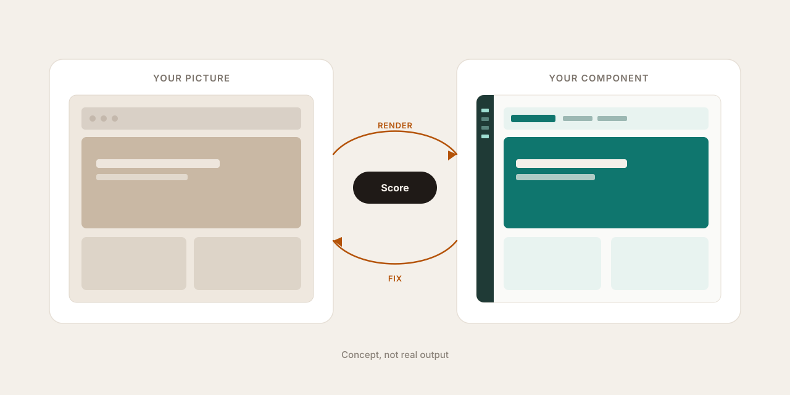
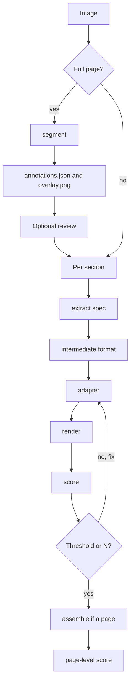
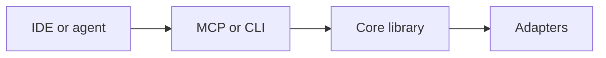

# Trace Anything

**Turn a picture of a web page into components you can actually keep.**

Give it a screenshot, it writes HTML/CSS/TS, renders it, checks the result against your picture and keeps fixing until they match.

> [!NOTE]
> This is spec stage. Nothing is implemented yet. The first work is the baseline in [issue #1](https://github.com/Troy-LL/trace-anything/issues/1). See [Where it's at](#where-its-at) for the rest.


[](LICENSE)


[](https://github.com/Troy-LL/trace-anything/actions/workflows/docs.yml)

<p>
  
</p>

Concept, not real output.

You give us a screenshot. We write the code, open the result at the same width as your picture, compare the two, and send the misses back into the next pass. That loop runs until the match is close enough, or we hit a round limit.

## Why not just paste the screenshot?

A screenshot in a div is a picture. You cannot edit the text, reuse a section, or keep a layout that belongs in your codebase.

We write real markup instead, then check that markup against your picture so the result stays honest.

## What you give it, what you get

| You give it | It does | You get |
| --- | --- | --- |
| A section image | Write the component, render it, score it, and fix the misses | A component, plus a score against that crop |
| A full-page image | Split the page into sections, wait for your review if you want it, then build each section and put the page back together | Annotations, an overlay, section crops, an assembled page, and a page-level score |
| A stack choice | Emit the project in that stack | A project that builds. For now that means plain HTML/CSS/TS, Vite, and a static build |
| A call from your editor | Run the same work over MCP or the CLI | JSON out. No editor-specific code in the core |

## See a run

This is the planned flow, not a captured result, and it invents no scores. The example input is a tall, single-column screenshot of the ASES Manila landing page. The image itself is not in this repo. The expected sections are listed in [design](docs/design.md#worked-example).

Split a full-page screenshot into labeled sections:

```text
trace segment
  in:   ases-manila-landing.png
  out:  annotations.json      section id, bbox, label, confidence, order
        overlay.png           boxes and labels, for review
        sections/sec-01.png   nav/header
        sections/sec-02.png   hero, "Build before it becomes obvious"
        ...                   (the rest of the page, in order)
        sections/sec-12.png   footer
```

Review the overlay, and edit `annotations.json` if a cut is wrong:

```text
# optional
edit annotations.json after looking at overlay.png
```

Build and score one section, then repeat for the rest of the page:

```text
trace loop
  in:   sections/sec-02.png, plus plain HTML/CSS/TS with Vite
  out:  out/sec-02/           the built component
        checks/sec-02.json    combined score vs that crop, written after the run
  then: generate, render, score, and fix until the threshold or N
```

Put the scored sections back together and score the whole page:

```text
trace assemble
  out:  out/page/             the stitched page
        checks/page.json      page-level score vs the original, written after the run
```

The same commands take JSON in and write JSON out. File layout is in [architecture](docs/architecture.md#project-files).

## How it checks its own work

We score the render against your picture with the signals below. Layout, text, and color are also scored on their own. Using your screenshot as a background image, or embedding it in the output in any other way, does not count.

We will also publish a comparison on the public Design2Code benchmark against screenshot-to-code and v0, using Design2Code's official metrics. We will put numbers here only after that run is committed. See [eval](docs/eval.md).

| Signal | What it catches |
| --- | --- |
| Perceptual | Overall visual closeness of the render to the picture |
| Layout / blocks | Missing, extra, or misplaced regions |
| OCR text | Copy that does not match the picture |
| Color | Fill and type color that does not match |

## Use it from your agent

Planned. You will be able to run the same work from a terminal, or from any MCP client such as Cursor, VS Code, Claude Code or Zed. The MCP server speaks stdio, and optionally HTTP. It never runs arbitrary commands.

Ask your agent:

```text
Here's a screenshot of my landing page. Segment it, let me review the overlay, then build each section in plain HTML, CSS and TypeScript with Vite and assemble the page. Tell me how close each section is to the picture.
```

Or from the terminal:

```text
# Planned
trace segment
trace loop
trace assemble
```

## How it's different from screenshot-to-code

- We render what we wrote, score it against your picture, and keep fixing until a threshold or a round limit. A single un-checked pass is not the product.
- We build one section at a time, then assemble the page. We do not generate a whole page in one shot.
- You get components you can keep, snapped to design tokens, not a one-off dump of guessed pixels.
- You can aim at more than one stack later. The first stack is plain HTML/CSS/TS with Vite.
- You can run it from a terminal or from any MCP client. Editor plugins come later.

## What counts as done

The first version is done only when all four of these hold. The full list is in [decision 005](docs/decisions/005-mvp-win-condition.md).

- [ ] On the same fixed Design2Code slice, with the same model, the single-section loop beats screenshot-to-code on the combined metric. Results and scripts are committed so anyone can rerun them.
- [ ] The ASES full-page example runs end to end: segment, review overlay, build every section in plain HTML/CSS/TS with Vite, assemble, and record the page-level score.
- [ ] The same run works from both the CLI and an MCP client, with JSON in and out.
- [ ] No image-as-background tricks, and each run stays under a set spend cap and round limit. Those values are TBD and will be set in [issue #1](https://github.com/Troy-LL/trace-anything/issues/1).

<details>
<summary>Under the hood</summary>

An editor-neutral library owns the pipeline. The CLI and the MCP server call that library. Adapters turn one shared description into a concrete project. The scoring loop stays the same when the stack changes. See [architecture](docs/architecture.md).



A harness talks to the same core:



| Path | What's in it |
| --- | --- |
| `annotations.json` | Section id, bbox, label, confidence, and order |
| `overlay.png` | The page image with boxes and labels |
| `sections/` | Cropped section images |
| `checks/` | Scores, mismatch regions, and score history |
| `out/` | The scaffolded project |

</details>

<details>
<summary>Stacks</summary>

You choose the framework, the build tool, the styling (and optionally your own tokens), and the deploy target. The tool does not deploy, and it does not handle account auth. See [architecture](docs/architecture.md) and [decision 001](docs/decisions/001-intermediate-format-and-adapters.md).

| Layer | First choice | Later |
| --- | --- | --- |
| Framework | Plain HTML/CSS/TS | React, Vue, Svelte, Leptos, Yew |
| Build tool | Vite | Next.js, Astro, Trunk |
| Styling | Plain CSS | CSS modules, Tailwind, or your own component library or tokens |
| Deploy target | Static | Vercel (`vercel.json`) or Cloudflare Pages/Workers (`wrangler.toml`), config only |

React, Tailwind, Rust, deploy configs, and editor plugins come after the first version.

</details>

<details>
<summary>Commands</summary>

These commands are specified, not implemented.

| CLI command | MCP tool | What it does | Status |
| --- | --- | --- | --- |
| `trace segment` | `segment` | Isolate a full-page image into annotated sections | Planned |
| `trace extract` | `extract` | Extract the spec and the intermediate tree | Planned |
| `trace generate` | `generate` | Emit a component through an adapter | Planned |
| `trace render` | `render` | Render the component at the image's exact width | Planned |
| `trace score` | `score` | Score the render and mark mismatches | Planned |
| `trace loop` | `loop` | Run extract through fix until the threshold or N | Planned |
| `trace assemble` | `assemble` | Stitch sections and score the full page | Planned |

</details>

## Where it's at

Spec stage. Nothing is implemented. Issues are the source of work.

| Issue | What | Depends on |
| --- | --- | --- |
| [#1](https://github.com/Troy-LL/trace-anything/issues/1) | Baseline: screenshot-to-code on a Design2Code slice | None. First, and measurement only. |
| [#2](https://github.com/Troy-LL/trace-anything/issues/2) | v0.1: single-section image to component loop | #1 |
| [#3](https://github.com/Troy-LL/trace-anything/issues/3) | Extra stacks, after the first version | #2 |
| [#4](https://github.com/Troy-LL/trace-anything/issues/4) | CLI and MCP server | #2 |
| [#5](https://github.com/Troy-LL/trace-anything/pull/5) | Product spec and docs, now on main | None. Docs pull request. |
| [#6](https://github.com/Troy-LL/trace-anything/issues/6) | Full-page input: segment, annotate, assemble | #2 |

Docs: [architecture](docs/architecture.md), [design](docs/design.md), [eval](docs/eval.md), [001](docs/decisions/001-intermediate-format-and-adapters.md), [002](docs/decisions/002-harness-neutral-interface.md), [003](docs/decisions/003-section-first.md), [004](docs/decisions/004-full-page-segment-and-assemble.md), [005](docs/decisions/005-mvp-win-condition.md).

## Want to help?

If you want to contribute before the first loop ships, these are useful starting points:

- An adapter for another stack, tracked in [issue #3](https://github.com/Troy-LL/trace-anything/issues/3).
- Ideas for how we should score a render, on [issue #1](https://github.com/Troy-LL/trace-anything/issues/1) and [issue #2](https://github.com/Troy-LL/trace-anything/issues/2).
- Test images for the hand-labeled full-page set, on [issue #6](https://github.com/Troy-LL/trace-anything/issues/6). Please do not send logos or pictures you cannot share.

See [CONTRIBUTING.md](CONTRIBUTING.md). Run `bash scripts/verify-docs.sh` before you ask for review.

## License

Apache License 2.0. Copyright 2026 Troy-LL. See [LICENSE](LICENSE).
