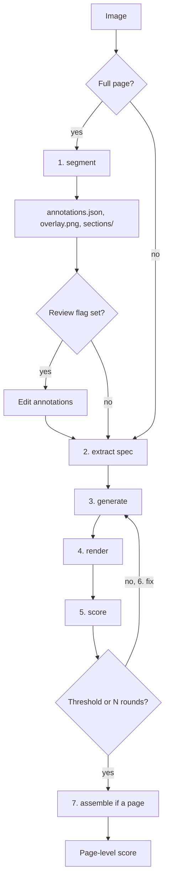

<h1 align="center">Trace Anything</h1>

<p align="center">
  <b>Reverse engineer any image into real HTML, CSS and TS components.</b>
</p>

<p align="center">
  
  
  
</p>

<p align="center">
  <a href="#how-it-works">How it works</a> ·
  <a href="#why-its-different">Why it's different</a> ·
  <a href="#use-it-from-anywhere">Use it from anywhere</a> ·
  <a href="#target-stacks">Target stacks</a> ·
  <a href="#project-files">Project files</a> ·
  <a href="#status-and-roadmap">Status and roadmap</a> ·
  <a href="#docs">Docs</a> ·
  <a href="#contributing">Contributing</a> ·
  <a href="#license">License</a>
</p>

Trace Anything takes a picture of a UI section, or a whole page, and turns it into a real component in the stack you pick. It extracts a visual spec, writes a framework-neutral intermediate description, emits code through an adapter, renders the result, scores it against the original, and fixes the mismatches until the score clears a threshold or hits a round limit. Nothing is implemented yet. This repository is the spec.

<table>
  <tr>
    <td width="25%" valign="top">
      <h3>From a picture</h3>
      A section or a full page goes in. A full page is isolated into annotated sections first. Each section is the unit of generation.
    </td>
    <td width="25%" valign="top">
      <h3>Closed loop</h3>
      Generate, render at the image's exact width, score, and fix, then repeat. The same scoring loop runs for every stack.
    </td>
    <td width="25%" valign="top">
      <h3>Any stack</h3>
      You pick the framework, build tool, styling, and deploy target. Adapters emit the code. Deploy config is generated. Nothing is deployed.
    </td>
    <td width="25%" valign="top">
      <h3>Any harness</h3>
      An editor-neutral library, a <code>trace</code> CLI with JSON in and out, and an MCP server (stdio, optional HTTP) so any MCP client can call it.
    </td>
  </tr>
</table>

## How it works

You give it a section image, or a whole-page picture. If the input is a full page, `segment` runs first. Each section then follows the loop below. A final assemble step stitches scored sections into a page and scores that page against the original too.

1. **Segment.** Detect section boundaries (horizontal bands first, then nested blocks), crop each section, assign a semantic label (nav/header, hero, features, testimonials, pricing, CTA, footer, other) with a confidence, and write `annotations.json` plus an annotated `overlay.png`. A person or agent can review or edit the annotations before generation. That checkpoint is optional via a flag.
2. **Extract spec.** Read text via OCR, colors, spacing, fonts, and layout boxes, snapped to design tokens, and write a framework-neutral intermediate component description (the spec plus the tree).
3. **Generate.** A target adapter emits HTML, CSS, and TS (or the target's equivalent) and a scaffolded project that builds, including deploy config when you asked for it.
4. **Render.** Playwright opens the build at the source image's exact width and captures a screenshot.
5. **Score.** Compare the screenshot to the original with a combined metric: perceptual similarity, block/layout match, OCR text match, and color.
6. **Fix.** Mark mismatched regions and feed them back into generate. Repeat until the score clears a documented threshold, or a maximum of N rounds.
7. **Assemble.** Stitch the scored sections into a page and score the whole page against the original full-page image.



Work happens one section at a time, not as a whole page in one shot. Segmentation feeds that loop; it does not replace it.

## Why it's different

- **Closed scoring loop.** The build is rendered and scored, and mismatches go back into generate, instead of a single un-checked pass.
- **Section-first.** A page is isolated into sections, each section is generated and scored, then the page is assembled. The generation unit stays one section.
- **Reusable components and tokens.** Output is meant to be kept: components in a real stack, with spacing, color, and type snapped to design tokens, not a one-off blob of guessed pixels.
- **Any stack, via adapters.** One intermediate description, then per-target adapters. The scoring loop does not change when the stack does.
- **Any IDE or harness.** The core is an editor-neutral library. The same operations are a CLI and an MCP server. Editor integrations are thin wrappers and are out of scope for v0.1.
- **Public benchmark, no score claims yet.** The goal is to beat screenshot-to-code and v0 on the public Design2Code benchmark, using Design2Code's official metrics (visual/CLIP, block match, text, position, and color), and to publish the comparison. Nothing is built yet, so this repo does not claim to beat anyone.

## Use it from anywhere

The same operations will be available as `trace` commands (JSON in, JSON out) and as MCP tools. Transport for the MCP server is stdio by default, and optionally HTTP. These commands and tools are specified, not implemented. They will work from a terminal with no editor, and from any MCP client such as Cursor, VS Code, Claude Code or Zed, or any other MCP-capable harness. No IDE-specific code belongs in the core.

### Planned CLI commands

| Command | Job | Status |
| --- | --- | --- |
| `trace segment` | Isolate a full-page image into annotated sections | Planned |
| `trace extract` | Extract the spec and the intermediate tree from a section image | Planned |
| `trace generate` | Emit a component through a target adapter | Planned |
| `trace render` | Render the component with Playwright at the image's exact width | Planned |
| `trace score` | Score the render against the image and mark mismatches | Planned |
| `trace loop` | Run extract, generate, render, score, and fix until the threshold or N | Planned |
| `trace assemble` | Stitch scored sections into a page and score that page against the original | Planned |

### Planned MCP tools

| Tool | Job | Status |
| --- | --- | --- |
| `segment` | Same as `trace segment` | Planned |
| `extract` | Same as `trace extract` | Planned |
| `generate` | Same as `trace generate` | Planned |
| `render` | Same as `trace render` | Planned |
| `score` | Same as `trace score` | Planned |
| `loop` | Same as `trace loop` | Planned |
| `assemble` | Same as `trace assemble` | Planned |

Planned stdio config for any MCP client (not implemented):

```json
{
  "mcpServers": {
    "trace-anything": {
      "command": "trace",
      "args": ["mcp"]
    }
  }
}
```

## Target stacks

You pick (a) the UI framework, (b) the build tool, (c) styling, and optionally your own component library or tokens, and (d) the deploy target. The first adapter (the reference adapter) is plain TS plus Vite plus static. The second is React plus Vite. Later options are listed, not built, in the first adapter pass. Deploy config is generated. The tool does not deploy, and it does not handle account auth.

| Choice | Option | Status |
| --- | --- | --- |
| Framework | Plain HTML/CSS/TS | First (reference adapter, with Vite and static) |
| Framework | React | First (with Vite) |
| Framework | Vue, Svelte, Leptos, Yew | Planned |
| Build tool | Vite | First |
| Build tool | Next.js, Astro, Trunk | Planned |
| Styling | Plain CSS | First |
| Styling | CSS modules, Tailwind, or your own component library or tokens | Planned |
| Deploy target | Static | First |
| Deploy target | Vercel (`vercel.json`) or Cloudflare Pages/Workers (`wrangler.toml`) | First (config only; nothing is deployed) |

## Project files

A run is planned to write this layout. See [architecture](docs/architecture.md#project-files) for the same list in context. Nothing is generated yet.

| Path | What it holds |
| --- | --- |
| `annotations.json` | Section id, bbox, label, confidence, and order |
| `overlay.png` | The page image with boxes and labels |
| `sections/` | Cropped section images |
| `checks/` | Scores, mismatch regions, and score history |
| `out/` | The scaffolded project, including deploy config when requested |

## Status and roadmap

Spec stage / pre-alpha. Nothing is implemented yet. The first work is a baseline, then a single-section loop, then adapters, a harness-neutral CLI and MCP server, and full-page segment and assemble. Issues are the specs.

| Issue | Title | Notes |
| --- | --- | --- |
| [#1](https://github.com/Troy-LL/trace-anything/issues/1) | Baseline: screenshot-to-code on a Design2Code slice | First. Measurement only. |
| [#2](https://github.com/Troy-LL/trace-anything/issues/2) | v0.1: single-section image to component loop | Depends on #1. |
| [#3](https://github.com/Troy-LL/trace-anything/issues/3) | Target stack options: framework, build tool, styling, deploy target | Depends on #2. |
| [#4](https://github.com/Troy-LL/trace-anything/issues/4) | Harness-neutral interface: CLI and MCP server | Depends on #2. |
| [#5](https://github.com/Troy-LL/trace-anything/pull/5) | Add product spec and docs | Documentation pull request, not a product issue. |
| [#6](https://github.com/Troy-LL/trace-anything/issues/6) | Full-page input: segment, annotate, assemble | Depends on #2. |

Limits that still hold: the generation unit is one section, not a whole page in one shot. Multi-page sites, Figma input, and a graphical product UI are out of scope for v0.1. Annotation review is JSON edit plus the overlay PNG, not an interactive GUI editor. Editor integrations are thin wrappers and are out of scope for v0.1.

## Docs

- [Architecture](docs/architecture.md)
- [Design](docs/design.md)
- [Eval](docs/eval.md)
- [001: Intermediate format and adapters](docs/decisions/001-intermediate-format-and-adapters.md)
- [002: Harness-neutral interface](docs/decisions/002-harness-neutral-interface.md)
- [003: Section first](docs/decisions/003-section-first.md)
- [004: Full-page input through segment and assemble](docs/decisions/004-full-page-segment-and-assemble.md)

## Contributing

See [CONTRIBUTING.md](CONTRIBUTING.md). Issues are the specs. Run `bash scripts/verify-docs.sh` before you ask for review.

## License

Apache License 2.0. Copyright 2026 Troy-LL. See [LICENSE](LICENSE).
