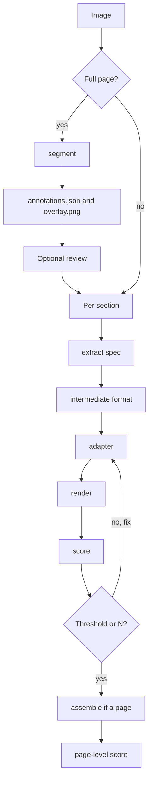
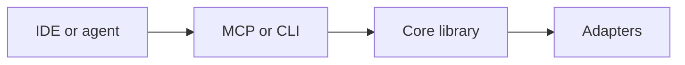

# Trace Anything


## Contents

- [The problem](#the-problem)
- [A run, end to end](#a-run-end-to-end)
- [What it does](#what-it-does)
- [Under the hood](#under-the-hood)
- [Commands](#commands)
- [Stacks](#stacks)
- [How we score](#how-we-score)
- [Done means](#done-means)
- [Where it's at](#where-its-at)

## The problem

You have a picture of a page, and you want real components that match it, not a screenshot pasted into a div.

This repo is the spec for a tool that does that. You give it a section or a whole page. It isolates the page into sections, writes HTML, CSS and TS, renders the result, scores it against the picture, and sends the misses back until the score clears a threshold or a round limit. Nothing is implemented yet.

The build is rendered and scored, and misses go back into generate. A page is cut into sections, each section is built and scored, then the page is assembled. The output is components you can keep, snapped to design tokens. We will publish a comparison on the public Design2Code benchmark against screenshot-to-code and v0. There is no win to claim until that run is committed.

## A run, end to end

The walk-through below is the planned flow, not a captured result, and it invents no scores. The example input is a tall, single-column screenshot of the ASES Manila landing page. The image itself is not in this repo. The expected section list is in [design](docs/design.md#worked-example).

```text
input:  ases-manila-landing.png

trace segment
  in:   the full-page PNG
  out:  annotations.json      section id, bbox, label, confidence, order
        overlay.png           boxes and labels, for review
        sections/sec-01.png   nav/header
        sections/sec-02.png   hero, "Build before it becomes obvious"
        ...                   (the rest of the page, in order)
        sections/sec-12.png   footer

  optional: edit annotations.json after looking at overlay.png

trace loop
  in:   sections/sec-02.png, plus plain HTML/CSS/TS with Vite
  out:  out/sec-02/           the built component
        checks/sec-02.json    combined score vs that crop, written after the run
  then: generate, render, score, and fix until the threshold or N
  repeat for every section

trace assemble
  out:  out/page/             the stitched page
        checks/page.json      page-level score vs the original, written after the run
```

The same commands take JSON in and write JSON out. Details of the loop, the annotation schema, and the files a run writes are in [design](docs/design.md) and [architecture](docs/architecture.md#project-files).

## What it does

| You give it | It does | You get |
| --- | --- | --- |
| A section image | Extract a spec, generate, render, score, and fix | A component, plus a score against that crop |
| A full-page image | Segment, optional review, the section loop, then assemble | Annotations, an overlay, section crops, an assembled page, and a page-level score |
| A stack choice | An adapter emits that stack | A scaffolded project that builds. MVP is plain HTML/CSS/TS, Vite, and static |
| A call from your editor | The same operations over MCP or the CLI | JSON out. No IDE-specific code in the core |

## Under the hood

An editor-neutral library owns the pipeline. The CLI and the MCP server call that library. Adapters turn one intermediate description (the spec plus the tree) into a concrete project. The scoring loop does not change when the stack does. See [architecture](docs/architecture.md).



A harness talks to the same core:



| Path | What's in it |
| --- | --- |
| `annotations.json` | Section id, bbox, label, confidence, and order |
| `overlay.png` | The page image with boxes and labels |
| `sections/` | Cropped section images |
| `checks/` | Scores, mismatch regions, and score history |
| `out/` | The scaffolded project |

## Commands

These operations are specified, not implemented. They work from a terminal, or from any MCP client such as Cursor, VS Code, Claude Code or Zed. The MCP server speaks stdio, and optionally HTTP. It never runs arbitrary commands. No IDE-specific code belongs in the core. Editor integrations are thin wrappers and are post-MVP.

| CLI command | MCP tool | What it does | Status |
| --- | --- | --- | --- |
| `trace segment` | `segment` | Isolate a full-page image into annotated sections | Planned |
| `trace extract` | `extract` | Extract the spec and the intermediate tree | Planned |
| `trace generate` | `generate` | Emit a component through an adapter | Planned |
| `trace render` | `render` | Render the component at the image's exact width | Planned |
| `trace score` | `score` | Score the render and mark mismatches | Planned |
| `trace loop` | `loop` | Run extract through fix until the threshold or N | Planned |
| `trace assemble` | `assemble` | Stitch sections and score the full page | Planned |

## Stacks

You choose the framework, the build tool, the styling (and optionally your own tokens), and the deploy target. The tool does not deploy, and it does not handle account auth. See [architecture](docs/architecture.md) and [decision 001](docs/decisions/001-intermediate-format-and-adapters.md).

| Layer | MVP choice | Later |
| --- | --- | --- |
| Framework | Plain HTML/CSS/TS | React, Vue, Svelte, Leptos, Yew |
| Build tool | Vite | Next.js, Astro, Trunk |
| Styling | Plain CSS | CSS modules, Tailwind, or your own component library or tokens |
| Deploy target | Static | Vercel (`vercel.json`) or Cloudflare Pages/Workers (`wrangler.toml`), config only |

React, Tailwind, Rust, deploy configs, and editor plugins are post-MVP.

## How we score

The combined score uses the signals below. Layout, text, and color are also scored separately. Official Design2Code metrics (visual/CLIP, block match, text, position, and color) are used on the baseline and for published comparisons. Embedding the source image, including as a background, is banned. See [eval](docs/eval.md).

| Signal | What it catches |
| --- | --- |
| Perceptual | Overall visual closeness of the render to the picture |
| Layout / blocks | Missing, extra, or misplaced regions |
| OCR text | Copy that does not match the picture |
| Color | Fill and type color that does not match |

## Done means

The MVP is won only when all four of these hold. The full decision is in [decision 005](docs/decisions/005-mvp-win-condition.md).

- [ ] On the same fixed Design2Code slice, with the same model, the single-section loop beats screenshot-to-code on the combined metric. Results and scripts are committed so anyone can rerun them.
- [ ] The ASES full-page example runs end to end: segment, review overlay, build every section in plain HTML/CSS/TS with Vite, assemble, and record the page-level score.
- [ ] The same run works from both the CLI and an MCP client, with JSON in and out.
- [ ] No image-as-background tricks, and each run stays under a set spend cap and round limit. Those values are TBD and will be set in [issue #1](https://github.com/Troy-LL/trace-anything/issues/1).

## Where it's at

Spec stage. Nothing is implemented. Issues are the specs.

| Issue | What | Depends on |
| --- | --- | --- |
| [#1](https://github.com/Troy-LL/trace-anything/issues/1) | Baseline: screenshot-to-code on a Design2Code slice | None. First, and measurement only. |
| [#2](https://github.com/Troy-LL/trace-anything/issues/2) | v0.1: single-section image to component loop | #1 |
| [#3](https://github.com/Troy-LL/trace-anything/issues/3) | Extra stacks, post-MVP | #2 |
| [#4](https://github.com/Troy-LL/trace-anything/issues/4) | Harness-neutral interface: CLI and MCP server | #2 |
| [#5](https://github.com/Troy-LL/trace-anything/pull/5) | Product spec and docs, now on main | None. Docs pull request. |
| [#6](https://github.com/Troy-LL/trace-anything/issues/6) | Full-page input: segment, annotate, assemble | #2 |

Docs: [architecture](docs/architecture.md), [design](docs/design.md), [eval](docs/eval.md), [001](docs/decisions/001-intermediate-format-and-adapters.md), [002](docs/decisions/002-harness-neutral-interface.md), [003](docs/decisions/003-section-first.md), [004](docs/decisions/004-full-page-segment-and-assemble.md), [005](docs/decisions/005-mvp-win-condition.md).

## Contributing

Issues are the specs. See [CONTRIBUTING.md](CONTRIBUTING.md). Run `bash scripts/verify-docs.sh` before you ask for review.

## License

Apache License 2.0. Copyright 2026 Troy-LL. See [LICENSE](LICENSE).
